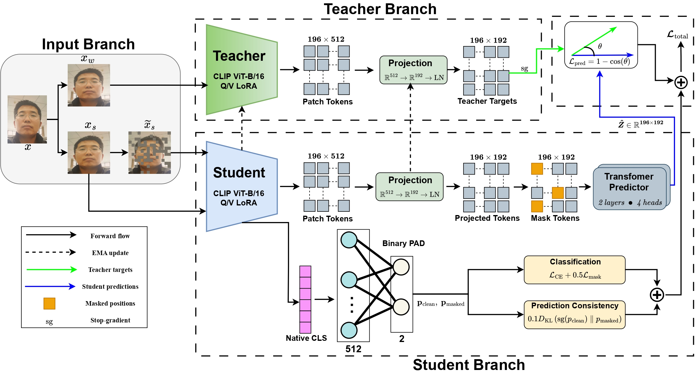
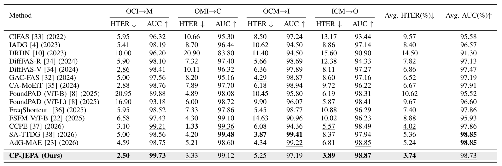

# CP-JEPA: Context-Predictive Low-Rank Adaptation for Face Presentation Attack Detection

CP-JEPA adapts a pretrained CLIP ViT-B/16 encoder for face presentation attack detection (PAD). Training combines supervised classification, masked spatial feature prediction, masked-view classification, and prediction consistency. Inference uses the adapted CLIP student and PAD classifier.

This repository contains the code and experiment records for standard OCIM cross-dataset evaluation, CelebA-Spoof additional-source training and transfer, two-source training, and SiW-Mv2 unseen-attack evaluation.

## Architecture



Training starts with cross-entropy (CE) adaptation using LoRA. CP-JEPA continues from the CE checkpoint, using an exponential-moving-average teacher to provide full-image targets for masked feature prediction.

## Repository structure

```text
cape_jepa/                    Training, evaluation, metrics, manifest preparation
models/                       Model definitions
datasets/                     Dataset loaders, MTCNN preprocessing, manifests
results/                      Experiment configurations and results
checkpoints/                  Downloaded checkpoints
figures/                      Architecture and results figures
requirements.txt              Dependencies
README.md
```

## Requirements

Python 3.11 and CUDA-enabled PyTorch. Install dependencies from the repository root:

```bash
pip install -r requirements.txt
```

Pretrained CLIP weights are required for model initialization.

## Datasets and preprocessing

Obtain the datasets from their providers. The standard OCIM membership file contains the following video counts:

| Dataset | Code | Train | Validation | Test |
| --- | :---: | ---: | ---: | ---: |
| OULU-NPU | O | 1,800 | 1,350 | 1,800 |
| CASIA-FASD | C | 240 | 240 | 360 |
| Replay-Attack | I | 360 | 360 | 480 |
| MSU-MFSD | M | 120 | 120 | 160 |
| **Total** | | **2,520** | **2,130** | **2,800** |

These counts follow `datasets/ocim_membership.json`. CelebA-Spoof is used as an additional source or transfer target; SiW-Mv2 is used for unseen-attack evaluation. Their splits are defined by the corresponding experiment manifests.

OCIM preprocessing uses MTCNN face cropping, followed by 224 × 224 resizing and CLIP normalization during data loading. The MTCNN implementation is in `datasets/mtcnn_preprocess.py`; OCIM membership and loading are defined in `datasets/ocim_membership.json` and `datasets/dataset.py`. Manifest-based datasets use `datasets/data_loader.py`. 


Prepare OCIM face crops using `datasets/mtcnn_preprocess.py`. Specify `--input` for the raw-video directory, `--output` for the preprocessed dataset directory, and `--dataset` as `CASIA`, `MSU`, `OULU`, or `RA`.

Specify the preprocessed dataset location using `--data-root` during training and evaluation. The expected directory structure is:

```text
/path/to/preprocessed_data/
├── OULU/
│   └── full/
│       ├── real/
│       └── attack/
├── CASIA/
│   └── full/
│       ├── real/
│       └── attack/
├── RA/
│   └── full/
│       ├── real/
│       └── attack/
└── MSU/
    └── full/
        ├── real/
        └── attack/
```

The train/validation/test video assignments are defined in `datasets/ocim_membership.json`.

CelebA-Spoof manifests are in `datasets/manifests/celeba/`, and the 14 SiW-Mv2 attack-category manifests are in `datasets/manifests/siw/`. Their image paths are relative to the specified data directory. For CelebA-Spoof, set `--celeba-root` to the directory containing `train/` and `test/`; the original images and `_BB.txt` annotations are required. For SiW-Mv2, set `--protocol-root` to the directory containing the separately preprocessed face crops under `full/`. The saved image paths must correspond to the entries in the selected protocol manifest.

## Checkpoints

**Hugging Face:** [CP-JEPA Checkpoints](https://huggingface.co/aminuyusufmr/cp-jepa)

Download the required checkpoints into `checkpoints/`, preserving the corresponding experiment directories.

| Protocol | Target | Standard OCIM CP-JEPA checkpoint |
| --- | :---: | --- |
| ICM → O | O | `checkpoints/main/cape/O/cape_O.pt` |
| OMI → C | C | `checkpoints/main/cape/C/cape_C.pt` |
| OCM → I | I | `checkpoints/main/cape/I/cape_I.pt` |
| OCI → M | M | `checkpoints/main/cape/M/cape_M.pt` |

Use the CE transition checkpoint to initialize CP-JEPA training and the selected CP-JEPA checkpoint for evaluation.

## Reproducing the experiments

Use `cape_finetune` for the original standard OCIM experiments. Use `two_stage` for additional-source training, CelebA-Spoof transfer, two-source OCIM, and SiW-Mv2 experiments.

### Training

With `two_stage`, run CE adaptation (`--stage ce`) first, then CP-JEPA adaptation (`--stage cape`) using the selected CE checkpoint. Both stages can run sequentially.

Example: two-source M+I → C/O training, with 40 epochs per stage:

```bash
python -m cape_jepa.train_cape_jepa \
  --workflow two_stage --sources M I --targets C O \
  --stage ce --epochs 40 --seed 42 \
  --output runs/two_source/ce && \
python -m cape_jepa.train_cape_jepa \
  --workflow two_stage --sources M I --targets C O \
  --stage cape --epochs 40 --seed 42 \
  --initial-checkpoint runs/two_source/ce/stage_transition.pth \
  --output runs/two_source/cape
```

For additional-source training, add `CelebA` to `--sources` and set `--celeba-manifest datasets/manifests/celeba/celeba_source.csv` and `--celeba-root /path/to/CelebA-Spoof/Data`. For CelebA-Spoof transfer, use `--targets CelebA` with `datasets/manifests/celeba/celeba_target.csv` and the same root. For SiW-Mv2, set `--protocol-manifest datasets/manifests/siw/Replay.csv` (or another attack category) and `--protocol-root /path/to/siw_crops`.

### Evaluation

Evaluate a checkpoint from `two_stage` with the corresponding target:

```bash
python -m cape_jepa.evaluate_cape_jepa \
  --workflow two_stage \
  --checkpoint checkpoints/EXPERIMENT/MODEL.pth \
  --target O \
  --output results/evaluation_O.csv
```

For SiW-Mv2, specify the attack-category manifest and crop directory:

```bash
python -m cape_jepa.evaluate_cape_jepa \
  --workflow two_stage --target O \
  --checkpoint /path/to/siw_checkpoint.pth \
  --protocol-manifest datasets/manifests/siw/Replay.csv \
  --protocol-root /path/to/siw_crops \
  --test-threshold --output results/siw_replay.csv
```

For CelebA-Spoof transfer, use `--target CelebA`, `--celeba-manifest datasets/manifests/celeba/celeba_target.csv`, and `--celeba-root /path/to/CelebA-Spoof/Data` with `two_stage`.

Evaluate a standard OCIM checkpoint with `cape_finetune`:

```bash
python -m cape_jepa.evaluate_cape_jepa \
  --workflow cape_finetune \
  --checkpoint checkpoints/main/cape/O/cape_O.pt \
  --test-threshold \
  --output results/evaluation_ocim.csv
```

### Experiment coverage

| Experiment | Setting | Records |
| --- | --- | --- |
| Standard OCIM | ICM → O, OMI → C, OCM → I, OCI → M | `results/main/`, `results/ablation/` |
| Additional source | Three OCIM sources + CelebA-Spoof → held-out OCIM target | `results/additional_source/` |
| CelebA-Spoof transfer | OCM → CelebA-Spoof | `results/celeba_transfer/` |
| Two-source | MI → C/O | `results/two_source/` |
| SiW-Mv2 | Held-out attack categories | `datasets/manifests/siw/` |

## Results




## Citation

Paper: [CP-JEPA preprint (link to be added)](https://example.com/).
